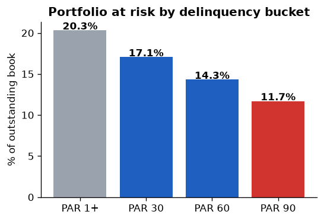
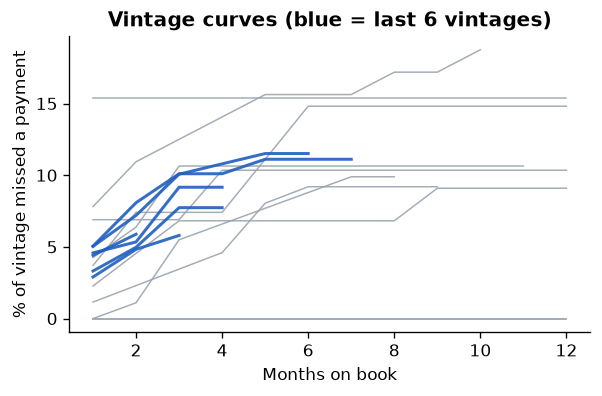
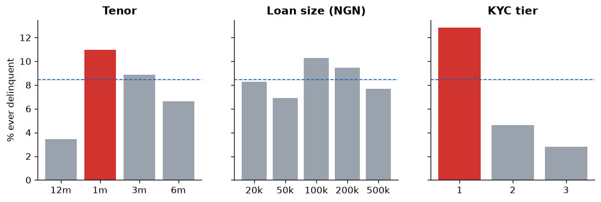

# Loan Portfolio Risk Dashboard


A credit-risk monitoring dashboard for a digital-lending book: **PAR 30/60/90, vintage curves and segment delinquency**, built from loan-level data with unit-tested metric definitions. Open `dashboard.html` locally (self-contained, no server) after running the build.

> Synthetic, seeded data. Metric definitions are documented in [`src/risk.py`](src/risk.py).

## Headline readout (as at 30 Jun 2025)
- Outstanding book **NGN 46.1m**, **PAR 30 = 17.1%**, **PAR 90 (NPL proxy) = 11.7%**.
- Delinquency is highest for **KYC tier 1 (12.9%)** and **paid_social-acquired** borrowers (12.5%) vs 8.5% average - an underwriting/acquisition signal.
- Recent vintages are still seasoning, so their curves understate eventual loss.





## Why it is fintech-relevant
Lenders live and die by PAR, NPL and vintage performance. The project shows the standard definitions implemented explicitly (DPD, outstanding, PAR-N), **tested** (`pytest`), and presented as a decision-ready dashboard with plain-English insights.

## Run it
```bash
pip install -r requirements.txt
python src/gen_data.py --out data/raw
PYTHONPATH=src python src/build_dashboard.py   # PowerShell: $env:PYTHONPATH="src"
pytest -q
```

## Next steps
Roll-rate matrices, expected-loss (PD x LGD x EAD) provisioning view, and a Power BI/Looker Studio port of the same model.
